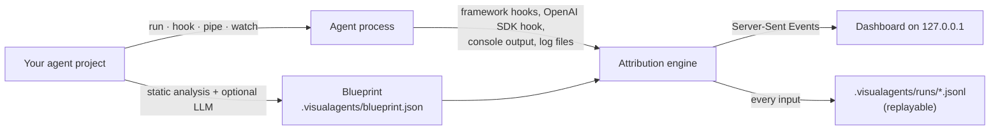

<p align="center">
  
</p>

<h1 align="center">VisualAgents</h1>

<p align="center">
  <b>A live map of which agent in your multi-agent AI system is doing what — built from its chain of thought.</b>
</p>

<p align="center">
  <a href="https://github.com/kaih06-hub/VisualAgents/actions/workflows/ci.yml"></a>
  <a href="https://pypi.org/project/visualagents/"></a>
  
  
  
  
</p>

<p align="center">
  
</p>

Multi-agent apps usually show you one long stream of thoughts and tool calls. You can't tell which specialist is
working, where the request is in the workflow, or why it just looped back. **VisualAgents** reads your agent
project, draws its agents and handoffs as a map, and lights that map up live while the agent works — from the
terminal, on your own machine, with no changes to your code.

---

**Contents** ·
[Highlights](#highlights) ·
[Quick start](#quick-start) ·
[Watching an agent live](#watching-an-agent-live) ·
[The dashboard](#the-dashboard) ·
[How it works](#how-it-works) ·
[Supported frameworks](#supported-frameworks) ·
[Choosing the LLM](#choosing-the-llm-that-draws-the-map) ·
[Instrument anything](#instrument-anything-yourself) ·
[Examples](#examples) ·
[CLI reference](#cli-reference) ·
[Privacy](#privacy-and-security) ·
[Troubleshooting](#troubleshooting)

---

## Highlights

- **Maps anything that calls an LLM.** Static analysis understands LangGraph, CrewAI, AutoGen, the OpenAI Agents SDK,
  Swarm, Google ADK, smolagents and LlamaIndex - and with no framework at all, every place that prompts a model is an
  agent, even if there is only one. An optional LLM pass (Claude, GPT, Gemini or a local model) adds roles, tools,
  handoffs and the step-by-step workflow.
- **Live map.** The working agent glows with a thought bubble, handoffs animate along the arrows (with ×N counts
  for loops), workflow steps tick off, and the chain of thought streams beside it — colour-coded per agent.
- **Rewind and replay.** A time ruler shows every agent's turn. Drag back to any second and the whole dashboard
  rewinds; press play to replay at up to 16×. Every run is recorded and can be replayed later.
- **No setup per project.** Run `visualagents` and answer three questions. It finds how the project starts, uses
  the project's own virtualenv, and remembers your choices. Or `hook` a folder once and keep running your agent
  however you like.
- **Precise where it can be, smart where it can't.** Auto-instrumentation gives exact agent boundaries for
  LangChain/LangGraph and the OpenAI Agents SDK, and catches every model call made through OpenAI, Anthropic, Gemini,
  LiteLLM, Ollama, mlx-lm, llama.cpp, transformers, vLLM, Groq or Hugging Face; anything else is attributed from
  the console output, with optional LLM narration.
- **Interactive.** Drag blocks around (arrows follow), hover a line of thought to make its agent bounce, click an
  agent for its own history, switch light/dark, share a link to an exact moment.
- **Private by default.** Everything runs on `127.0.0.1`. Your code only goes to an LLM if you pick one, with
  secrets redacted first.

## Quick start

### 1. Install

Requires Python 3.10+.

```bash
pipx install "visualagents[all]"
```

or `uv tool install "visualagents[all]"`, or `pip install "visualagents[all]"` into any environment.
Claude support is built in; `[all]` adds Gemini and OpenAI / OpenAI-compatible servers (Ollama, LM Studio, vLLM).
Latest from GitHub: `pipx install "visualagents[all] @ git+https://github.com/kaih06-hub/VisualAgents.git"`.

### 2. See it work (no API key)

```bash
visualagents demo
```

A simulated four-agent research crew — planner → researcher → writer ⇄ critic — runs in your terminal while the
dashboard maps it.

### 3. Point it at your own agent

```bash
visualagents
```

Three questions, then your agents' map pops up:

```text
  VisualAgents  · a live map of your agents
  Three questions, then your agents' map pops up. Ctrl+C to quit.

1/3 Which project should VisualAgents map?
  ✔ ~/VisualAgents/examples/langgraph_supervisor

2/3 Which LLM should read the code and draw the map?
  ✔ Google Gemini
  Model
  ✔ gemini-flash-latest

3/3 Google Gemini API key
  Paste it below - it stays hidden · get one at https://aistudio.google.com/apikey · empty = skip
  API key:
  ✔ Key works · 34 models available
  ✔ Saved to ~/.visualagents/keys.json

  ✔ Found 4 agent(s): Supervisor, Researcher, Coder, Reviewer  (langgraph)
  ✔ Map is open at http://127.0.0.1:7420

▶ Watch it live?
  ❯ Start it now  python app.py
    Start it with a different command…
    Hook it - I'll start it myself  IDE, scripts, notebooks: it shows up whenever it runs
    Just show the map
```

1. **Project** — a recent one, the current folder, any path (Tab completes), or a GitHub URL, which it clones.
2. **LLM** — Gemini, Claude, OpenAI, a local / OpenAI-compatible server, or offline; then a model (best / cheaper /
   cheapest, or any id).
3. **API key** — pasted hidden, checked with a free model-list call, and (if you agree) saved to
   `~/.visualagents/keys.json`, readable only by you. Next time you just press Enter through the defaults.

Menus work with the arrow keys (or j/k and numbers).

## Watching an agent live

The map moves only while the agent is **actually working**. VisualAgents watches; it doesn't do the work. So:

1. **Start the agent** — choose *Start it now* in the terminal, or press **▶ Start** on the map. VisualAgents runs
   the project's start command in your terminal.
2. **Give it a task**, the way that agent takes input:
   - agents that ask questions in the terminal (e.g. TradingAgents asks for a ticker) → answer them there;
   - web-app agents (e.g. LAMBDA) → open the agent's own page and type your request;
   - agents that take the task as an argument → put `{task}` in the start command
     (`visualagents run . -- python main.py "{task}"`) and a *What should it do?* box appears on the dashboard.
3. **Watch** the map light up. When the run ends, **▶ Run again** starts the next one.

There are three ways to connect VisualAgents to an agent — pick whichever fits how you work:

| | Command | Best for |
|---|---|---|
| **Guided** | `visualagents` | Getting started: project → LLM → key → map → start. |
| **Run through it** | `visualagents run <folder>` | Repeating runs. Finds how the project starts (README commands, `start.sh`, FastAPI / Gradio / Streamlit / Chainlit apps, `__main__` scripts, `pyproject`, `package.json`, Makefile), asks once, remembers it in `.visualagents/config.json`, and uses the project's virtualenv (or `uv run` / `poetry run`). |
| **Hook once** | `visualagents hook <folder>` | Running the agent your usual way — IDE, scripts, notebooks, cron. Installs a one-line startup file into the project's virtualenv; every Python process from it appears on a background dashboard (http://127.0.0.1:7400) as soon as it calls an LLM. `pip`, `pytest` and editor tools stay invisible. |

```bash
visualagents run ~/projects/my-agent --pick                 # choose the start command again
visualagents run ~/projects/my-agent -- python main.py "q"  # or give an exact command
visualagents hook ~/projects/my-agent                       # then: ./start.sh, your IDE, …
visualagents status | open <folder> | unhook <folder> | up | down
```

Start scripts that push the app into the background or send its output to a log file still work: events reach
the dashboard over HTTP, and `*.log` files the app writes are followed. You can also feed it output you already
have: `python main.py 2>&1 | visualagents pipe .`, or `visualagents watch . --log run.log`.

## The dashboard

### Live map


- **Graph** — agents laid out in workflow order (left→right, or top→bottom on narrow screens). The working agent
  glows with a bubble showing what it's thinking; finished agents get a ✓; arrows show who hands work to whom,
  with traversal counts. Two-way handoffs are drawn as parallel arrows; handoffs that weren't in the blueprint
  appear dotted, and agents it missed appear dashed.
- **Steps** — the blueprint's phases across the top, checked off as the run moves through them.
- **Working now** — the active agent, its current activity, time in this turn, tool calls and handoffs.
- **Live chain of thought** — every thought, tool call, result and answer, colour-coded per agent; filter by agent
  or hide plain logs. Hover any line and its agent lights up and bounces on the map.
- **Drag any block** to rearrange the map — arrows follow, positions are remembered per project, and the layout
  button restores the automatic layout. Click a block for that agent's details and its own chain of thought.

### Blueprint


The first time you open a project the blueprint pops up (press **B** any time): a summary, where requests enter and
which agent answers, the step-by-step flow, every agent with its role, tools and source location, and every
handoff. It scrolls in one column, top to bottom.

### Time ruler — rewind and replay


Each agent's turn is a segment on the ruler, with the workflow steps above it. Drag the playhead back and the
whole dashboard rewinds — who was working, which step, what it was thinking, and the chain of thought up to that
second (later lines dim). **▶ / Space** replays at 1–16×; **Live / L** jumps back to now.

### Dark mode and small screens

<table>
  <tr>
    <td width="72%"></td>
    <td></td>
  </tr>
</table>

Light, dark or follow the system (button in the top right). On narrow screens the map flows top-to-bottom.

### Shortcuts and links

| Key | Action | | Link option | Effect |
|---|---|---|---|---|
| `B` | blueprint popup | | `?t=42` | open rewound to 0:42 of the run |
| `F` | fit the map | | `?theme=dark` / `light` | force a theme |
| `Space` | play / pause the replay | | `?popup=0` / `1` | hide / show the blueprint popup |
| `L` | back to live | | `?live=0` | a still snapshot (no streaming) |
| `←` `→` | step 1 s on the ruler (Shift: 10 s) | | `?project=<id>` | pick a project on the background dashboard |
| `Esc` | close popups | | | |

## How it works



1. **Blueprint.** `visualagents scan` (run for you on first use) reads the most agent-relevant files. Static
   analysis finds agents, tools and handoffs for the frameworks below; the optional LLM pass returns each agent's
   role, description, tools, source location, log aliases and keywords, the handoff graph, entry/exit agents and
   the general workflow, as schema-checked JSON. You can commit or hand-edit the result.
2. **Attribution.** While the agent runs, three sources say which agent is doing what, from most to least precise:

   | Source | When | What you get |
   |---|---|---|
   | **Auto-instrumentation** | Python apps using LangChain / LangGraph, the OpenAI Agents SDK, or **any LLM library directly**: OpenAI (and compatible endpoints), Anthropic, Gemini, LiteLLM, Ollama, mlx-lm, llama.cpp, transformers, vLLM, Groq, Hugging Face Inference (sync, async, streaming) | Exact agent boundaries, the prompt as the task, replies and `<think>` reasoning as thoughts, every tool call and result — no code changes. Each model call is credited to the class or function that made it (e.g. `Programmer`, `answer_question`), looking past shared helpers. Turn off with `--no-instrument`. |
   | **Console patterns** | Always | CrewAI (`# Agent: …`, rich panels), AutoGen (`coder (to critic):`), LangGraph stream output, ReAct (`Thought:` / `Action:` / `Observation:` / `Final Answer:`), handoff phrases (`Handing off to Writer`, `transfer_to_billing`), `[Agent] …` prefixes, and tools owned by one agent. |
   | **LLM narration** (`run --smart`) | Optional | Every few seconds an LLM reads the latest output and names the working agent with a one-line summary. |

3. **Dashboard.** A small local web server streams the state to the browser; the map, steps, feed and ruler are
   rebuilt from the event log, which is what makes rewinding possible.

## Supported frameworks

| Framework | Mapped from the code | Followed live |
|---|---|---|
| **LangGraph** | `add_node`, `add_edge`, `add_conditional_edges`, `Command(goto=…)`, `create_react_agent`, supervisors | callbacks: exact node turns, LLM replies, tool calls |
| **LangChain** | agents and their tools | callbacks: thoughts, actions, results |
| **CrewAI** | `Agent` / `Task` / `Crew`, `config/agents.yaml` + `tasks.yaml`, hierarchical crews | console format |
| **AutoGen** 0.2 / 0.4 | agents, `GroupChat`, `RoundRobinGroupChat`, `SelectorGroupChat`, `Swarm`, `initiate_chat` | console format |
| **OpenAI Agents SDK** | `Agent(handoffs=…)`, `as_tool` | tracing: agent spans, handoffs, tools |
| **No framework** - OpenAI, Anthropic, Gemini, LiteLLM, Ollama, mlx-lm, llama.cpp, transformers, vLLM, Groq, Hugging Face, LangChain chat models | every function or class that calls a model is an agent (a shared `generate_reply()`-style helper is not: its callers are); one call site = a one-agent system | each call credited to the code that made it, with its prompt, reply, reasoning, tool calls and results |
| **Swarm**, **Google ADK**, **smolagents**, **LlamaIndex** | `transfer_to_*`, `sub_agents`, `managed_agents`, `AgentWorkflow` | console patterns, `--smart` |
| **LangGraph.js**, JS/TS agents | `addNode` / `addEdge`, `new Agent({ name })` | console patterns |
| **Anything else** | the LLM pass | console patterns, `--smart`, or the SDK below |

## Choosing the LLM that draws the map

| Provider | Key | Default map model | Default `--smart` model |
|---|---|---|---|
| `anthropic` | `ANTHROPIC_API_KEY` or `ant auth login` | `claude-opus-5-5` | `claude-opus-5-5` |
| `openai` | `OPENAI_API_KEY` (+ `OPENAI_BASE_URL` for Ollama, LM Studio, vLLM…) | `gpt-5` | `gpt-5` |
| `google` | `GEMINI_API_KEY` / `GOOGLE_API_KEY` (or Vertex AI) | `gemini-pro-latest` | `gemini-flash-lite-latest` |

```bash
visualagents models                                   # which providers have keys, and their defaults
visualagents models --provider google                 # every model your account can use
visualagents scan . --provider google --model gemini-flash-latest
visualagents scan . --static                          # offline only
```

A free Gemini key has no quota for the Pro models: pick `gemini-flash-latest` there, or enable billing on the key.

Keys and choices are read from, in order: your shell environment, the project's `.env`, then what the guided
start saved. You can also set `VISUALAGENTS_PROVIDER`, `VISUALAGENTS_MODEL` and `VISUALAGENTS_NARRATE_MODEL`.
Gemini requests retry automatically when the model is busy.

## Instrument anything yourself

From any language, print a line:

```text
@@visualagents {"type": "agent_start", "agent": "researcher", "text": "find sources"}
```

From Python:

```python
from visualagents import agent, emit, handoff, track

with agent("researcher", task="find sources"):
    emit("thought", "researcher", "Start with peer-reviewed numbers")
    emit("tool_start", "researcher", "solid-state battery Wh/kg", tool="web_search")
handoff("researcher", "writer", "findings ready")

@track("critic")                      # the whole function is the critic's turn
def review(draft): ...
```

Event types: `agent_start`, `agent_end`, `thought`, `tool_start`, `tool_end`, `handoff`, `output`, `log`, `error`.
Under `visualagents run` the dependency-free runtime is importable even if VisualAgents isn't installed in your
app's environment (`from visualagents_runtime import agent, emit`), and marker lines are hidden from your terminal.
Without `run`: LangChain → `callbacks=[visualagents.langchain_handler()]`; OpenAI Agents SDK →
`agents.add_trace_processor(visualagents.openai_agents_processor())`.

## Examples

| Example | Try it |
|---|---|
| Simulated research crew (built in) | `visualagents demo` |
| [LangGraph supervisor team](https://github.com/kaih06-hub/VisualAgents/tree/main/examples/langgraph_supervisor) — runs offline | `pip install langgraph` then `visualagents run examples/langgraph_supervisor` |
| [CrewAI template](https://github.com/kaih06-hub/VisualAgents/tree/main/examples/crewai_project) — YAML agents and tasks | `visualagents scan examples/crewai_project` |
| [Hand-rolled agents with `emit`](https://github.com/kaih06-hub/VisualAgents/tree/main/examples/manual_sdk) | `visualagents run examples/manual_sdk` |

**LAMBDA (a data-science agent).** [LAMBDA](https://github.com/AMA-CMFAI/LAMBDA) is a FastAPI backend plus a React
UI that calls the OpenAI SDK directly, and its `start.sh` runs both in the background:

```bash
git clone https://github.com/AMA-CMFAI/LAMBDA.git ~/LAMBDA
cp ~/LAMBDA/backend/.env.example ~/LAMBDA/backend/.env    # add its model key
visualagents run ~/LAMBDA                                  # pick ./start.sh the first time
```

Ask LAMBDA something at http://localhost:3000 and watch it at http://127.0.0.1:7420. The paper's
Programmer ⇄ Inspector design is on its `legacy-open-source` branch, where the map shows the two agents handing
work back and forth.

## CLI reference

```text
visualagents                 guided start (same as `visualagents setup`)
visualagents demo            [--speed N]
visualagents run             [FOLDER] [--pick] [--smart] [--cwd DIR] [--no-instrument] [--no-follow-logs] [-- COMMAND…]
visualagents hook            [FOLDER] [--python PY]…
visualagents unhook | open   [FOLDER]
visualagents up              [--port 7400] [--foreground]
visualagents down | status
visualagents scan            [FOLDER] [--static | --llm] [--provider auto|anthropic|openai|google] [--model M] [--json] [-o FILE]
visualagents models          [FOLDER] [--provider anthropic|openai|google]
visualagents show | blueprint [FOLDER]
visualagents pipe            [FOLDER] [--quiet]
visualagents watch           [FOLDER] --log FILE [--from-start] [--echo]
visualagents replay          RECORDING [--project DIR] [--speed N] [--instant]

dashboard options:  --port 7420  --host 127.0.0.1  --no-browser  --blueprint FILE  --exit  --rescan
```

`vagents` is a short alias. `visualagents <command> --help` explains every option.

### Files it creates

| Where | What |
|---|---|
| `<project>/.visualagents/blueprint.json` | the map — commit it or hand-edit it |
| `<project>/.visualagents/config.json` | the remembered start command |
| `<project>/.visualagents/runs/*.jsonl` | recorded runs for `replay` (git-ignored) |
| `~/.visualagents/settings.json`, `keys.json` | guided-start choices and saved keys (`keys.json` is readable only by you) |
| `~/.visualagents/registry.json`, `daemon.json` | hooked projects and the background dashboard |
| `<venv>/site-packages/visualagents_hook.pth` | the hook (`visualagents unhook` removes it) |

## Privacy and security

- The dashboard binds to `127.0.0.1` only; events from your agent need a per-session token.
- Nothing leaves your machine unless you choose an LLM provider. Before code is sent, `.env`, key and credential
  files are skipped and strings that look like API keys are redacted.
- Saved keys live in `~/.visualagents/keys.json` with owner-only permissions. No telemetry.
- Instrumentation never changes your agent's behaviour or output, and stays silent in processes that never call
  an LLM.

## Troubleshooting

| Problem | Fix |
|---|---|
| `visualagents: command not found` | Install it (see [Quick start](#1-install)); make sure `~/.local/bin` is on your `PATH`. |
| The map doesn't move | The agent isn't working on anything yet — press **▶ Start** and give it a task ([details](#watching-an-agent-live)). |
| "No virtualenv found" | Create one in the project (`python3 -m venv .venv && .venv/bin/pip install -r requirements.txt`), or `hook --python /path/to/python`. |
| The agent fails with import errors | Its own dependencies aren't installed in the environment it runs with — install them, then **▶ Run again**. |
| The LLM scan failed | VisualAgents falls back to the offline map. Retry, or pick another model (`visualagents models --provider …`). |
| An agent is missing or misnamed | `visualagents scan <folder> --llm` for a richer map, or edit `.visualagents/blueprint.json`. Agents seen only at runtime still appear (dashed). |
| Wrong start command | `visualagents run <folder> --pick`. |

## Development

```bash
git clone https://github.com/kaih06-hub/VisualAgents.git && cd VisualAgents
python -m venv .venv && . .venv/bin/activate
pip install -e ".[dev,all]"
pytest
```

The dashboard is plain HTML/CSS/JS in `visualagents/web/` (no build step). New console formats go in
`visualagents/patterns.py`, new static detectors in `visualagents/static_scan.py`, start-command detection in
`visualagents/detect.py`, and runtime hooks in `visualagents/_autoinstrument/visualagents_runtime.py`.

## License

MIT
